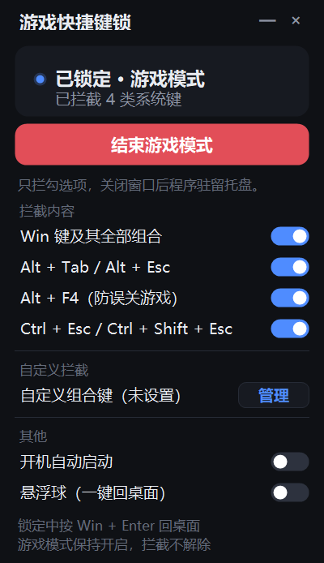

# 游戏快捷键锁 · GameKeyGuard

> 玩游戏时把 Win 键、Alt+Tab 这些「一按就切出去」的系统快捷键拦下来。
> A tiny Windows utility that blocks system shortcuts (Win / Alt+Tab / Alt+F4 / Ctrl+Esc …) while gaming.

单文件绿色 exe，免安装，不需要任何运行库（基于系统自带的 .NET Framework 4.8）。



## 功能特性

- **一键锁定**：点一下「启动游戏模式」，`Win`、`Alt+Tab`、`Alt+Esc`、`Alt+F4`、`Ctrl+Esc`、`Ctrl+Shift+Esc` 全部拦下。
- **只拦该拦的**：WASD、技能键、打字完全不受影响；每一项都能单独开关。
- **自定义组合键**：想拦 `Shift+Alt+A` 之类的任意组合也行。录入时会临时挂上底层键盘钩子，靠「后挂的先调用」抢在其他软件前面拿到按键，所以即使这个组合键已经被模拟器 / 语音 / 截图工具占用，也能被本程序拦下。
- **锁定中回桌面**：按 `Win + Enter` 随时把桌面调出来，**游戏模式保持开启**，不用重新锁定。
- **悬浮球**：可选的置顶小圆球，鼠标点一下 = 按一次 `Win + Enter`，全屏游戏里也够得着。
- **托盘常驻**：关窗口自动缩到托盘，右键即可结束锁定或退出。
- **开机自启**、**深色极简界面**。

## 快速开始

1. 直接下载本仓库根目录的 `游戏快捷键锁.exe`（绿色单文件），或者按下面的说明自己编译。
2. 双击运行，按需勾选要拦截的组合键。
3. 点蓝色大按钮「启动游戏模式」——窗口不会自动隐藏，停在原处显示「已锁定」。
4. 玩完想解除：点红色按钮「结束游戏模式」，或右键托盘图标 → 结束游戏模式。
5. 关闭主窗口只是缩到托盘，要彻底退出请用托盘菜单的「退出程序」。

## 拦截项说明

| 项目 | 说明 |
| --- | --- |
| Win 键及其全部组合 | 单按 Win、Win+D/E/R/S/X/L/I/M、Win+Tab、Win+空格 等 |
| Alt + Tab / Alt + Esc | 防止误切到桌面 |
| Alt + F4 | 防止误关游戏 |
| Ctrl + Esc / Ctrl + Shift + Esc | 防止弹出开始菜单 / 任务管理器 |
| 自定义组合键 | 任意「修饰键 + 按键」，如 Shift+Alt+A、Ctrl+Alt+Q |

## 自定义拦截组合键

主界面「自定义拦截」一行点 **管理**：

1. 点「+ 按下快捷键添加」，按钮变红；
2. 直接按下要拦的组合键（例如 `Shift + Alt + A`），松手即添加；
3. 每条右侧有开关（关掉=暂时不拦）和 `×`（删除）；
4. 录入过程中按 `Esc` 取消；
5. 至少要带一个修饰键（Ctrl / Alt / Shift / Win），否则会破坏正常打字，程序会拒绝录入。

## 游戏中想回桌面

开着游戏模式玩全屏游戏时 `Alt+Tab`、`Win` 都被拦住了，回桌面有三种办法：

1. **按 `Win + Enter`**（推荐）：立刻把桌面调出来，**游戏模式仍然开着、快捷键继续被拦**，切回游戏点任务栏图标即可。
2. **点悬浮球**：先在主界面打开「悬浮球（一键回桌面）」，锁定期间屏幕右下角的小圆球点一下等同 `Win + Enter`。
3. **游戏自带的方法**：CS2 里按 `Alt + Enter` 可以切到窗口模式（这个键没有被拦），再点任务栏回桌面。
   也可以把游戏设成「全屏窗口化」，这样悬浮球和主界面更容易看到。

> **原理**：`Win + Enter` 是本程序在拦截规则之外单独识别的一条热键。识别到之后，程序用 **注入按键** 的方式替你按一次 `Win + D`；
> 注入的按键带 `LLKHF_INJECTED` 标记，本程序的钩子会放行，所以不需要解除锁定就能把桌面调出来。
> 想真正结束游戏模式，仍然要点主界面的红色按钮，或托盘菜单的「结束游戏模式」。

## 已知限制（不是 bug）

1. **`Ctrl + Alt + Del` 拦不了**：它是 Windows 的安全序列，由内核处理，任何用户态程序都拦不住。
2. **管理员权限的游戏**：如果游戏以管理员身份运行，本程序也要用「托盘右键 → 以管理员身份重启」运行，
   否则系统会挡住低权限程序对高权限窗口按键的拦截。
3. **内核反作弊游戏**（无畏契约 Vanguard、PUBG BattlEye、EAC 等）：本程序安装的是全局键盘钩子，
   这类程序有可能把它拦下或不认，介意的话玩这些游戏时不要开。
4. **为什么不做「不挂钩子的兼容模式」**：实测在 Windows 11 上，`Alt+Tab`、`Ctrl+Esc`、`Ctrl+Shift+Esc`、
   `Win+*` 都已被系统外壳用 `RegisterHotKey` 占住（返回错误 1409），不挂钩子根本抢不过来，拦不住任何有用的键。
   所以本项目只保留钩子引擎这一条路。

## 从源码构建

需要 Windows 10/11，**不需要安装任何 SDK**（用系统自带的 .NET Framework 编译器）：

```powershell
# 在仓库根目录执行
powershell -ExecutionPolicy Bypass -File .\build.ps1          # 只编译
powershell -ExecutionPolicy Bypass -File .\build.ps1 -Test    # 编译 + 编译自检程序
.\_selftest.exe                                               # 运行自检（40 项断言）
```

`build.ps1` 会调用 `gen_icon.ps1` 生成多尺寸图标，然后用 `%WINDIR%\Microsoft.NET\Framework64\v4.0.30319\csc.exe`
把 `src\*.cs` 编译成 `游戏快捷键锁.exe`。

## 项目结构

```
├─ src\                 全部 C# 源码（WinForms + .NET Framework 4.8，C# 5 语法）
│  ├─ Program.cs        入口、单实例、DPI、异常日志
│  ├─ MainForm.cs       主界面与托盘
│  ├─ KeyboardGuard.cs  底层键盘钩子（拦截引擎 + 组合键录制）
│  ├─ CustomKeysForm.cs 自定义组合键管理弹窗
│  ├─ FloatBall.cs      悬浮球
│  ├─ Controls.cs / Theme.cs / TrayIcons.cs   自绘控件与主题
│  └─ AppSettings.cs    配置读写
├─ tests\
│  ├─ TestMain.cs       40 项自动化断言
│  └─ HookProbe.cs      端到端按键注入测试（需在真实桌面运行）
├─ build.ps1            一键编译
├─ gen_icon.ps1         生成多尺寸 ico
├─ 使用说明.md           完整使用说明
└─ previews\            界面截图
```

## 常见问题

**Q：为什么关窗口不退出？**
A：为了打游戏时减少干扰，关窗口只缩到托盘；彻底退出请用托盘菜单的「退出程序」。

**Q：为什么有时候拦不住？**
A：三种常见原因 —— ① 游戏以管理员权限运行（请用「以管理员身份重启」）；
② 那个组合键被更晚安装钩子的程序抢先处理；③ 游戏带内核反作弊，直接屏蔽了所有全局钩子。
锁定期间所有带修饰键的按键都会记录到 `%APPDATA%\GameKeyGuard\keys.log`，可以据此排查。

**Q：配置存在哪？**
A：`%APPDATA%\GameKeyGuard\settings.ini`，日志在同目录。删掉这个文件夹即可恢复默认。

## 许可证

[MIT](LICENSE)